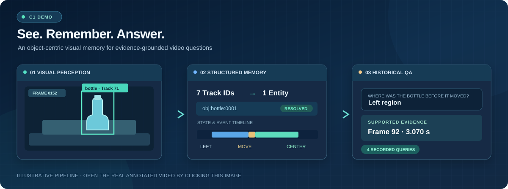

<div align="center">

# RecallVision

### See. Remember. Answer.

**Object-Centric Visual Memory for Retrospective Video Question Answering**

A computer vision course project that turns frame-level observations into persistent object histories, supported events, and evidence-linked answers.

[**▶️ C1 Analysis Video**](https://github.com/suibianba12138/RecallVision-Course/blob/gh-pages/case-studies/media/c1-analysis.mp4) · [**📖 Architecture**](docs/ARCHITECTURE.md) · [**💻 Code**](recallvision/)


</div>

---

<div align="center">

[](https://github.com/suibianba12138/RecallVision-Course/blob/gh-pages/case-studies/media/c1-analysis.mp4)

**Click the illustration to play the published C1 analysis video.**  
*The diagram is illustrative; the linked MP4 contains annotations derived from recorded observations.*

</div>

## 🎬 Demo — From Video to Visual Memory

The [**C1 analysis video**](https://github.com/suibianba12138/RecallVision-Course/blob/gh-pages/case-studies/media/c1-analysis.mp4) shows recorded detections, track IDs and structured event annotations from a **7.91-second bottle clip**. The frozen query answers remain available as JSON artifacts in this repository.

<div align="center">

[**▶ Watch the recorded C1 analysis video →**](https://github.com/suibianba12138/RecallVision-Course/blob/gh-pages/case-studies/media/c1-analysis.mp4)

</div>

The recorded demonstration follows a single bottle across time:

<div align="center">

| 01 · Perception | 02 · Memory | 03 · Retrieval |
| :---: | :---: | :---: |
| **48** bottle observations | **7 → 1** track IDs to persistent entity | **4** recorded query routes |
| YOLO11n + ByteTrack | State timeline + `MOVE_OBJECT` | Answer + timestamp + frame |

</div>

**Example — “Where was the bottle before it moved?”**

> **Left region**, supported by **frame 92 (3.0697 s)**. The observed movement event links left and center state segments over **3.0697–3.3033 s**.

The public MP4 is an **annotated analysis export**, not the original raw source clip. Boxes and IDs are rendered only at frames with recorded observations; the published JSON includes **precomputed C1 answers**, not fresh YOLO inference or a live Python QA service. See [media provenance and export details](https://github.com/suibianba12138/RecallVision-Course/blob/gh-pages/case-studies/media/README.md).

## ✨ Highlights

- **Visual perception:** YOLO11n detection and ByteTrack short-term tracking, including bounding boxes, timestamps, confidence and tracker IDs.
- **Persistent entity memory:** consolidate compatible tracklets into an object-centric identity rather than assuming a tracker ID is permanent.
- **State and event timelines:** remember supported object locations and evidence-bounded changes, including `MOVE_OBJECT`.
- **Evidence-grounded retrieval:** return a recorded answer alongside a timestamp, frame, object ID or event reference.
- **Explicit uncertainty:** preserve ambiguous or unsupported results rather than inventing an answer.

## 🧩 How It Works

```text
               OFFLINE: BUILD MEMORY
Video
  └─ YOLO11n + ByteTrack            Frame-level object observations
      └─ Persistent entity (P2A-R1) Consolidate compatible tracklets
          └─ State timeline (P2B)   Where objects were observed
              └─ Event memory       Supported zone and movement events
                  (P2C/P2D)

               QUERY TIME: RETRIEVE
Question
  └─ Typed query handler
      └─ Stored memory + authorized attribution (where applicable)
          └─ Answer + evidence timestamp / frame
```

The query handlers read **saved memory artifacts**, avoiding repeated video perception at query time. Their available answers depend on whether the relevant identity, state and event are sufficiently supported.

For stage contracts, modules and CLI boundaries, see [**System Architecture**](docs/ARCHITECTURE.md).

## 💬 What Can It Answer?

| Query type | Question | Recorded C1 answer |
|---|---|---|
| `WHERE_OBJECT` | Where was the bottle last observed? | Center region · **5.0717 s**, frame 152 |
| `WHEN_OBJECT_MOVED` | When did the bottle move? | Supported interval **3.0697–3.3033 s**, frames 92–99 |
| `WHERE_OBJECT_BEFORE` | Where was it before that movement? | Left region · frame 92 |
| `WHO_MOVED_OBJECT` | Who moved the bottle? | `obj:person:0001` from **pre-authorized attribution memory** |

These are **frozen development-artifact results**. The WHO answer is read from an already-authorized event record; it is **not** automatic person attribution at query time. The movement interval bounds observed evidence, not the exact physical onset of motion.

## 🚀 Quick Start

**Requirements:** Python 3.10+.

```bash
git clone https://github.com/suibianba12138/RecallVision-Course.git
cd RecallVision-Course

python3 -m venv .venv
source .venv/bin/activate        # Windows: .venv\Scripts\activate
python -m pip install -e ".[test]"
python -m pytest -q
```

The source tree includes schemas, memory/event/query modules, configurations, CLIs and lightweight tests. The last recorded public-source check was **158 passed, 4 skipped**; optional OpenCV and local-artifact-dependent cases account for skips. These tests are **not** an end-to-end video evaluation.

For optional detector/tracker dependencies:

```bash
python -m pip install -e ".[perception]"
```

You will also need an appropriate PyTorch environment and separately obtained `yolo11n.pt` weights for perception. Installing dependencies alone does not generate the C1 demo artifacts.

### Explore Recorded Outputs

Real C1 JSON artifacts are committed under [`course_demo/fixture/`](course_demo/fixture/):

```text
course_demo/fixture/
├── manifest.json
├── artifacts/
│   ├── persistent_entities.json
│   ├── object_state_timelines.json
│   ├── move_object_events.json
│   └── authorization_report.json
└── queries/
    ├── where_object.json
    ├── when_object_moved.json
    ├── where_object_before.json
    └── who_moved_object.json
```

To locally obtain and hash-check the **exact original input videos**, see [**Course Reproduction Guide**](docs/COURSE_REPRODUCTION.md). Original third-party MP4 inputs, the internal evidence JPGs, model weights and full internal replay adapter are not included in the public `main` branch. The [C1 annotated analysis video](https://github.com/suibianba12138/RecallVision-Course/blob/gh-pages/case-studies/media/c1-analysis.mp4) is published separately on `gh-pages`.

## 📂 Repository Layout

```text
recallvision/       Perception, entity-memory, event, and query code
configs/            Frozen stage configurations
course_demo/fixture Recorded C1 memory and query JSON
tests/              Source-level and contract checks
docs/               Architecture, validation, third-party notices, reproduction
public-demo/        Lightweight source-only summary
```

## 📊 Evaluation Scope

**What we can show:** a real C1 development video with recorded detections, persistent object memory, an evidence-supported movement event and four recorded query outcomes.

**What is not established:** reliable fresh-video end-to-end question answering, long-video generalization, cross-video robustness or automatic VLM person attribution. Independent-video diagnostic outcomes are documented transparently in [**Validation Results**](docs/VALIDATION_RESULTS.md); they are not presented as successful demonstrations.

The project is an **educational system prototype**, not a new object detector or a validated general-purpose video QA model.

## 🔗 More Information

[**C1 Analysis Video**](https://github.com/suibianba12138/RecallVision-Course/blob/gh-pages/case-studies/media/c1-analysis.mp4) ·
[**Architecture**](docs/ARCHITECTURE.md) ·
[**Reproduction**](docs/COURSE_REPRODUCTION.md) ·
[**Validation**](docs/VALIDATION_RESULTS.md) ·
[**Media Credits**](https://github.com/suibianba12138/RecallVision-Course/blob/gh-pages/case-studies/media/README.md)

## 📜 License & Credits

Original RecallVision-Course source and documentation: **[AGPL-3.0-only](LICENSE)**, © 2026 suibianba12138. Third-party software and media retain their own terms; see [COPYRIGHT](COPYRIGHT) and [Third-Party Notices](docs/THIRD_PARTY_NOTICES.md).

Perception uses [Ultralytics YOLO](https://github.com/ultralytics/ultralytics) and its ByteTrack integration. The C1 video is sourced from [Pixabay video 82261](https://pixabay.com/videos/bottle-hands-water-liquid-table-82261/); the published annotated composite and media provenance are documented [here](https://github.com/suibianba12138/RecallVision-Course/tree/gh-pages/case-studies/media).

---

<div align="center"><sub>RecallVision · Computer Vision Course Project · Structured memory, inspectable evidence.</sub></div>
